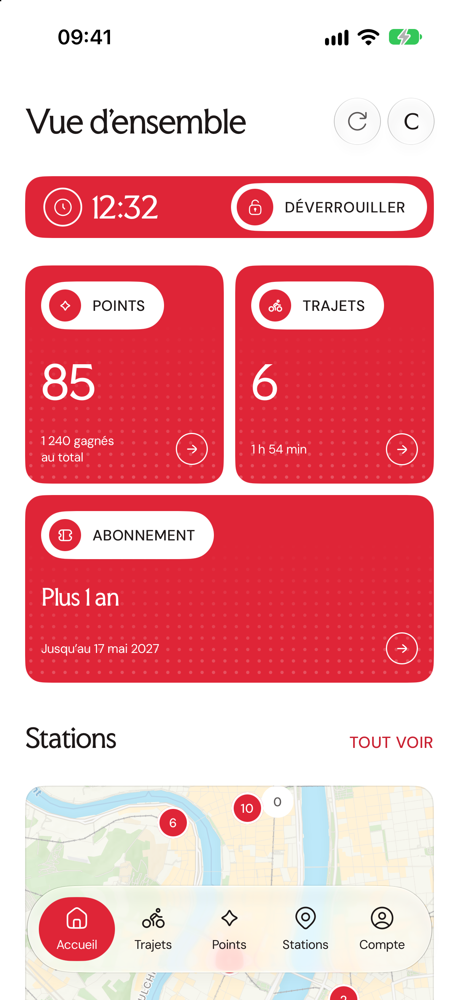
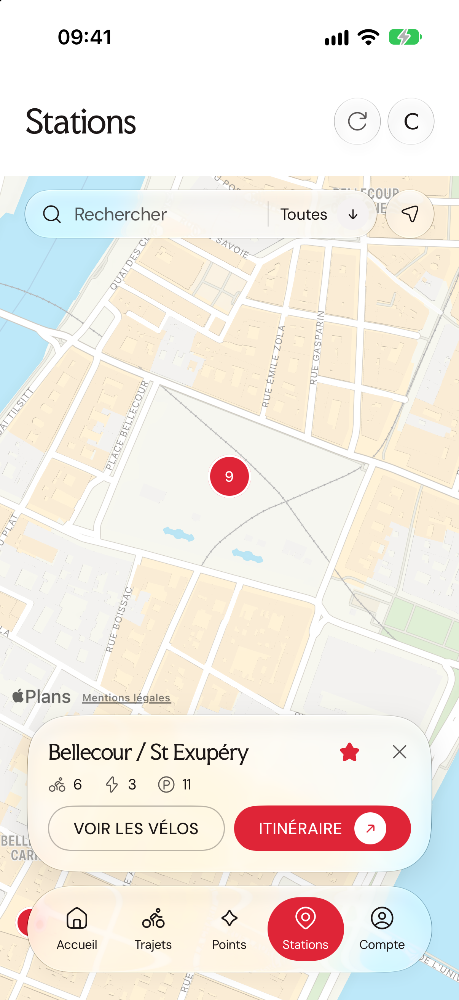
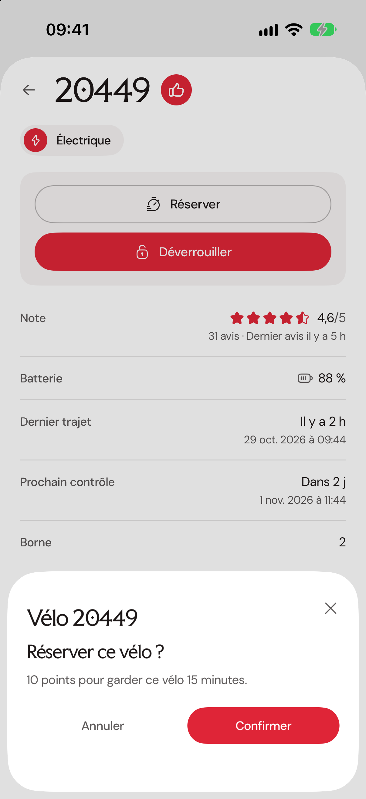
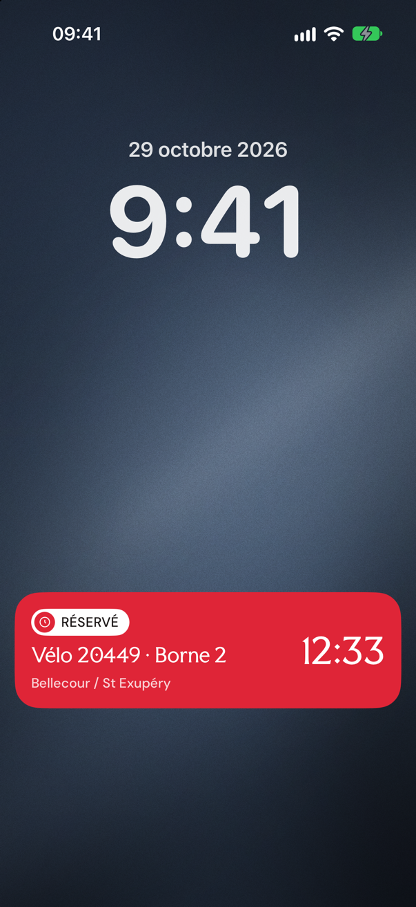
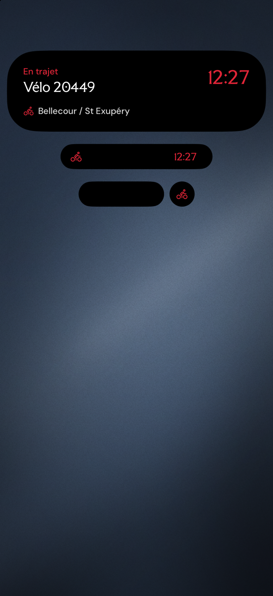
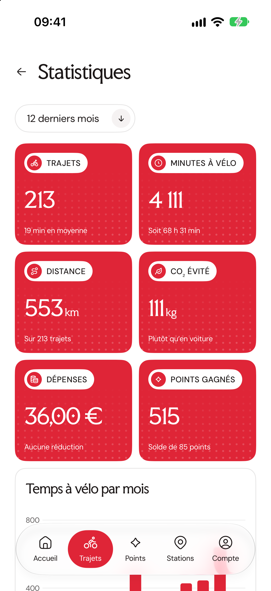
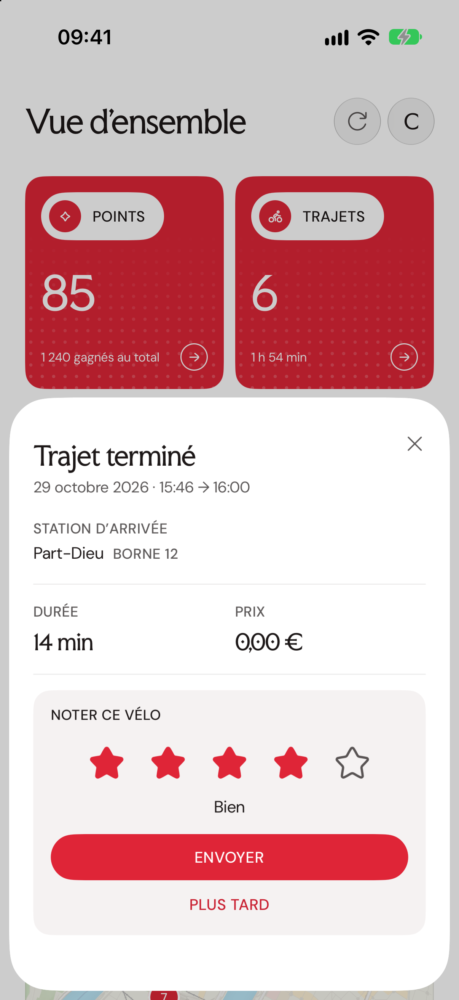

# Vélo’v+ pour iPhone

Vélo’v+ est une application iPhone native qui accompagne le compte Vélo’v, le vélo en libre-service de Lyon. Elle reprend le design et les textes de la [version web](https://velovplus.vercel.app) et parle directement à l’API Cyclocity, sans serveur intermédiaire : vos identifiants et vos jetons restent sur le téléphone.

Il s’agit d’un projet personnel et non officiel. Il n’est affilié ni à Vélo’v, ni à la Métropole de Lyon, ni à JCDecaux ou Cyclocity.

<p align="center">
  
  
  
  
  
  
  
</p>

## Ce que fait l’application

La vue d’ensemble affiche le solde de points, le nombre de trajets, l’abonnement en cours et une carte des stations proches. Chaque carte mène à la page détaillée correspondante.

La page Stations montre toutes les stations sur une carte, avec une recherche, des filtres et un bouton « Autour de moi ». En touchant une station, on voit les vélos présents borne par borne. Chaque vélo reçoit une note calculée à partir des avis, de la batterie et de son dernier trajet, ce qui permet de repérer d’un coup d’œil les vélos recommandés et ceux à éviter.

Depuis la fiche d’un vélo, on peut le réserver (10 points pour le garder 15 minutes) ou le déverrouiller. Une réservation en cours apparaît dans un bandeau de l’app, et aussi sur l’écran verrouillé et dans la Dynamic Island grâce à une Activité en direct qui affiche le compte à rebours. Une fois le vélo déverrouillé, une autre Activité en direct affiche le temps écoulé, la station de départ et le numéro du vélo.

Pendant un trajet, l’app surveille le retour du vélo tant qu’elle est ouverte. Quand le vélo est raccroché, une fiche « Trajet terminé » résume le trajet et propose de noter le vélo. Si la station d’arrivée est pleine, « 15 minutes de plus » permet de demander du temps supplémentaire pour rejoindre une autre station.

La page Trajets liste l’historique avec le détail de chaque trajet, et la page Statistiques en tire des chiffres sur une période au choix : temps passé à vélo, distance estimée, CO₂ évité, dépenses, horaires de départ et stations les plus utilisées. La page Points détaille les gains et les dépenses.

La page Compte permet de modifier ses coordonnées, de gérer le renouvellement automatique de l’abonnement, de télécharger ses justificatifs en PDF, d’écrire au service client et d’échanger des points contre un code d’invitation à offrir.

## Sans compte

Le bouton « Continuer sans compte », sous le formulaire de connexion, ouvre l’app sans compte Vélo’v. On y garde la carte des stations, la recherche, les filtres, « Autour de moi », la liste des vélos de chaque station avec leur fiche, et « Itinéraire ». Les favoris restent possibles, mais ils sont enregistrés sur le téléphone et non sur le compte. La réservation, le déverrouillage, les trajets, les statistiques, les points et la page Compte n’existent pas dans ce mode, et l’app n’y suit aucun trajet : ni surveillance du retour du vélo, ni Activité en direct, ni fiche « Trajet terminé ». Le bouton « Se connecter » reste toujours visible en haut de la page Stations, et la fiche d’un vélo propose un lien vers la connexion à la place des actions. Ce choix est mémorisé sur le téléphone, sans identifiant ni jeton. Les stations viennent des flux publics de Vélo’v et les vélos se lisent avec le jeton de l’application, qui ne demande aucun compte ; le détail des fonctions publiques se trouve dans `docs/guest-mode.md` du dépôt web.

## Règles de sécurité des actions

Une action qui modifie le compte (réserver, déverrouiller, noter, modifier son profil…) passe toujours par une feuille de confirmation, et une confirmation envoie exactement une requête. L’app ne renvoie jamais une écriture automatiquement, même quand la réponse se perd : une réponse absente peut cacher une réservation ou un déverrouillage qui a bien eu lieu.

Quand le résultat est incertain (pas de réponse, délai dépassé, erreur 5xx, erreur sans code), la feuille n’offre plus que « Fermer » et prévient que le résultat est incertain, pour qu’on vérifie l’état réel avant de recommencer. Le statut et le code renvoyés par le serveur ne s’affichent pas : ils restent dans le Journal technique de la page Compte. Seul un refus certain permet de confirmer à nouveau.

Les lectures, elles, sont réessayées au plus trois fois et seulement sur les erreurs 502, 503 et 504 de la passerelle, jamais après un délai dépassé. Un code d’invitation obtenu contre des points est enregistré sur le téléphone avant toute autre chose, car il est la seule preuve du débit.

Le fichier [DECISIONS.md](DECISIONS.md) détaille ces règles et les choix de conception.

## Comment c’est construit

L’interface est écrite en SwiftUI pour iOS 18 et plus. Toute la logique métier vit dans le paquet Swift `Packages/VelovCore` : modèles, normalisation des réponses, dates, note des vélos, messages d’erreur, réseau, connexion (PKCE, trousseau iOS, identifiant d’appareil stable) et écritures. Ce paquet ne dépend pas de SwiftUI, ce qui permet de le tester sur le Mac.

Le projet Xcode n’est pas versionné : XcodeGen le génère à partir de `project.yml`. L’extension `Widgets` contient les Activités en direct de la réservation et du trajet en cours, démarrées et arrêtées par l’app elle-même, sans notification push. Le dossier `Shared` regroupe le code et les icônes communs à l’app et à l’extension.

| Dossier | Contenu |
| --- | --- |
| `App` | L’application : système de design, écrans, état et données d’exemple |
| `Packages/VelovCore` | La logique métier et ses tests |
| `Widgets` | L’extension avec l’Activité en direct |
| `Shared` | Le code et les icônes partagés entre l’app et l’extension |
| `scripts` | Téléchargement des polices et icônes, icône de l’app, captures d’écran, installation |

## L’installer sur son iPhone

Un compte Apple gratuit suffit. Il faut un Mac avec Xcode 27 ou plus récent, [Homebrew](https://brew.sh) et XcodeGen (`brew install xcodegen`). Avec un compte gratuit, l’app signée cesse de s’ouvrir au bout de 7 jours : il suffit alors de la réinstaller, et la session comme les codes d’invitation restent sur le téléphone.

### Une seule fois, sur le Mac

1. Ajoutez votre compte Apple dans Xcode, dans Réglages > Comptes. Xcode crée alors une équipe personnelle.
2. Copiez le fichier d’exemple : `cp Local.example.xcconfig Local.xcconfig`. Ce fichier n’est pas versionné.
3. Renseignez `DEVELOPMENT_TEAM` avec l’identifiant à dix caractères de votre équipe. Le plus simple est d’ouvrir le projet dans Xcode après un `make project`, de choisir votre équipe dans Signing & Capabilities, puis de lire la valeur avec `xcodebuild -showBuildSettings | grep DEVELOPMENT_TEAM`.
4. Renseignez `VELOV_DEVICE` avec l’UDID de votre iPhone, que donne `xcrun xctrace list devices` quand l’iPhone est branché.

L’identifiant de bundle `io.github.dailyxplorer.velov` est déjà enregistré par un autre compte : remplacez-le dans `project.yml` (`bundleIdPrefix` et les deux `PRODUCT_BUNDLE_IDENTIFIER`) par un identifiant à vous.

### Une seule fois, sur l’iPhone

1. Branchez l’iPhone au Mac, déverrouillez-le et touchez « Se fier » s’il le demande.
2. Activez le mode développeur dans Réglages > Confidentialité et sécurité > Mode développeur, laissez l’iPhone redémarrer puis confirmez. Si l’option n’apparaît pas encore, elle apparaîtra après la première installation.
3. Après la première installation, faites confiance au certificat dans Réglages > Général > VPN et gestion de l’appareil.
4. Vérifiez que les Activités en direct sont autorisées dans Réglages > Vélo’v+.

### À chaque installation

Lancez `make build && make install` depuis le dossier du projet, dans la session graphique du Mac, car la signature a besoin du trousseau déverrouillé. Un double-clic sur `scripts/install.command` dans le Finder fait la même chose et écrit le résultat dans `~/.velov-ios-install.log`, qui se termine par `DONE` ; la ligne `exit status 0` juste avant indique que tout s’est bien passé.

L’installation fonctionne par câble USB, et aussi en Wi‑Fi une fois que l’iPhone a été appairé et qu’il est connecté au même réseau que le Mac.

Loin de ce réseau, aucune installation à distance ne marche avec un compte gratuit. Xcode et `devicectl` ne trouvent pas l’iPhone à travers un VPN comme Tailscale, car la découverte des appareils passe uniquement par Bonjour : ni l’adresse IP, ni MagicDNS, ni un relais `_remotepairing._tcp` déclaré à la main ne suffisent. Une installation par lien `itms-services` (IPA signée servie par `tailscale serve`) se télécharge, mais iOS la refuse avec « Impossible d’installer… Réessayez ultérieurement », en Debug comme en Release.

Pour lever la limite de 7 jours, il faut un compte développeur payant (un an, avec TestFlight), passer par SideStore ou AltStore, ou réinstaller depuis le Mac tous les 6 jours.

Si Xcode répond « No Accounts » ou « No profiles », ouvrez `VelovCompagnon.xcodeproj`, choisissez votre équipe dans Signing & Capabilities pour les cibles VelovCompagnon et VelovWidgets, puis relancez la commande. Si l’app se ferme dès l’ouverture, c’est que les 7 jours sont écoulés : réinstallez-la.

## Commandes utiles

| Commande | Effet |
| --- | --- |
| `make project` | Télécharge les polices et icônes manquantes, dessine l’icône et génère le projet Xcode |
| `make build-unsigned` | Compile l’app pour iPhone sans la signer |
| `make build` | Compile l’app signée pour l’iPhone déclaré dans `Local.xcconfig` |
| `make install` | Installe la dernière compilation signée sur cet iPhone |
| `make test` | Lance les tests de `VelovCore` sur le Mac |
| `make smoke` | Fait quelques lectures publiques sur le vrai service |
| `make snapshots` | Produit des captures des écrans principaux dans le simulateur, dans `snapshots/` |

## Tests

`make test` lance les tests unitaires du paquet `VelovCore` sur le Mac. Chaque appel réseau passe par un faux `URLProtocol` : les tests couvrent la connexion, le renouvellement de session, les lectures, chaque écriture et ses règles d’envoi unique, sans jamais contacter Vélo’v. `make smoke` se limite à des requêtes GET publiques (la liste des stations et les vélos d’une station) et n’utilise aucun compte.

### Captures d’écran

`make snapshots` produit les captures des écrans principaux. Les images du README, dans `docs/screenshots`, en sont une sélection à demi-résolution (vue d’ensemble avec bandeau, stations, confirmation de réservation, activité du trajet sur l’écran verrouillé, statistiques, trajet terminé) : refaites-les dès que l’interface change visiblement. Les captures des Activités en direct sont posées sur un fond d’écran calme dessiné par le script (ardoise, lumière douce floutée, grain, barre d’état blanche), jamais sur un dégradé voyant ni sur une photo téléchargée.

Les états qui demandent un toucher (menu ouvert, feuille ouverte) se capturent avec XCUITest. Ajoutez un test dans `UITests/` qui touche les éléments et écrit des PNG avec `XCUIScreen.main.screenshot()` dans le dossier donné par `ProcessInfo.processInfo.environment["VELOV_SHOT_DIR"]` (voir `UITests/SelectMenuUITests.swift`), lancez `make project` après avoir ajouté le fichier, puis :

```sh
TEST_RUNNER_VELOV_SHOT_DIR=/tmp/velov-shots xcodebuild test -project VelovCompagnon.xcodeproj -scheme VelovCompagnon \
  -destination 'platform=iOS Simulator,id=<UDID du simulateur>' \
  -derivedDataPath "$HOME/Library/Developer/Xcode/DerivedData/VelovCompagnon-make" \
  -only-testing:VelovCompagnonUITests/<Classe>
```

Le préfixe `TEST_RUNNER_` transmet la variable au lanceur de tests. L’app se lance avec `-VelovSample YES -VelovScreen <écran>`, les écrans étant ceux de `SnapshotScreen`. Une exécution prend de 5 à 8 minutes. Désignez un bouton par son libellé d’accessibilité complet : un préfixe comme « Trajet » touche aussi l’onglet Trajets. Écrivez un PNG de diagnostic quand un élément manque, pour voir ce qui était à l’écran. Un état absent des données d’exemple (un trajet en cours pour « 15 minutes de plus ») se prépare par une modification temporaire de `App/Model/SampleData.swift`, annulée avec `git checkout` avant tout commit. Regardez chaque PNG.

## Liens

- Version web : [velovplus.vercel.app](https://velovplus.vercel.app)
- Code de la version web : [DailyXplorer/velov-plus](https://github.com/DailyXplorer/velov-plus)

## Avertissement

L’app utilise l’API non documentée de Cyclocity, l’opérateur de Vélo’v. Elle peut cesser de fonctionner à tout moment si cette API change. Certaines écritures du compte reposent sur des formats de requête déduits de clients existants et non confirmés par l’opérateur ; elles sont signalées dans [DECISIONS.md](DECISIONS.md). Vous utilisez l’app à vos risques, avec votre propre compte.

## Licence

Projet personnel, tous droits réservés.

Les polices Velov Glyphic, version modifiée de Faculty Glyphic produite par `scripts/make-number-font.py`, et DM Sans sont distribuées sous licence SIL Open Font License, et les icônes proviennent du jeu gratuit Hugeicons, sous licence MIT. Leurs licences se trouvent dans `App/Resources/Licenses`.
